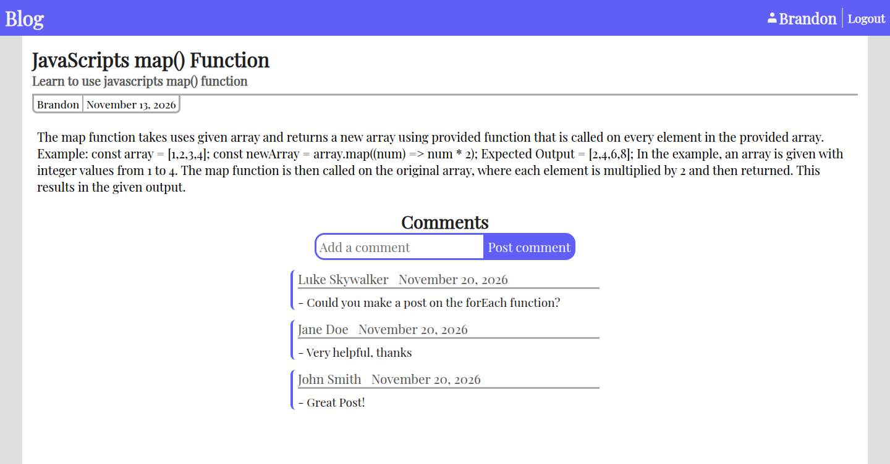

# Blog Public

**Live Preview:** https://blog-public.onrender.com/

**API:** https://github.com/Salypse/blog-api

Front-end Blog application that allows users to view published posts and leave comments on them.



## Features

### Posts

- Calls API to retrieve all published posts
- List of all posts on homepage with previews to their content
- Dedicated pages to each post where users can view author info, post content, and comments left on post

### Comments

- When viewing a post users can leave comments on any post as long as they are logged in
- Comments display users name, date post was created, the comment message, and the option to delete the comment if they created it

### Authentication

- Handles authentication for API requests using JWT access and refresh tokens
- Automatically refreshes expired access tokens when possible

## Technologies Used

- JavaScript
- HTML
- CSS
- React
- Vite
- Vitest

## Prerequisites

- Node.js
- Access to a deployed instance of the Blog API
- npm

## Installation

1. Clone the repository and enter directory

```bash
git clone https://github.com/Salypse/blog-public.git
cd blog-public
```

2. Install dependencies

```bash
npm install
```

3. Create a .env file in the project root

```bash
touch .env
```

```env
# .env

VITE_API_URL=deployed_blog_api_url
```

**If deploying your own instance, ensure the frontend URL is included in the API's allowed CORS origins.**

4. Start the application

```bash
npm run dev
```
